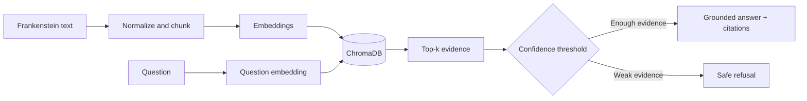

# Frankenstein RAG Assistant

A portfolio-ready Retrieval-Augmented Generation project that uses Mary
Shelley's *Frankenstein* as a document knowledge base. It retrieves relevant
passages, generates evidence-grounded answers, adds source references, refuses
weakly supported questions, and includes an evaluation workflow.

## Highlights

- End-to-end RAG pipeline
- Overlapping chunking and semantic retrieval
- ChromaDB cosine-similarity index
- Confidence-based safe refusal
- Chunk-level evidence and citations
- Twelve-question evaluation design
- Controlled chunk-size and top-k experiments
- Gradio demo interface
- Modular Python package and tests

## Structure

```text
frankenstein-rag-assistant/
├── app.py
├── notebooks/frankenstein_rag.ipynb
├── src/frankenstein_rag/
├── data/
├── tests/
├── docs/index.html
├── .env.example
├── requirements.txt
└── README.md
```

## Architecture



## Run locally

```bash
python -m venv .venv
pip install -r requirements.txt
```

Copy `.env.example` to `.env`, add your API key, and set an available chat model.
Then run:

```bash
python app.py
```

Upload a UTF-8 text edition of *Frankenstein*, build the index, and ask questions.

## Evaluation

The notebook includes Recall@k, MRR, answer accuracy, refusal accuracy,
citation accuracy, latency, token usage, controlled experiments, charts,
and error analysis.

## Security

Never commit `.env`, API keys, tokens, or private documents.

## Author

**Aynura Akhmedova** — Computational Linguistics · NLP · Python
