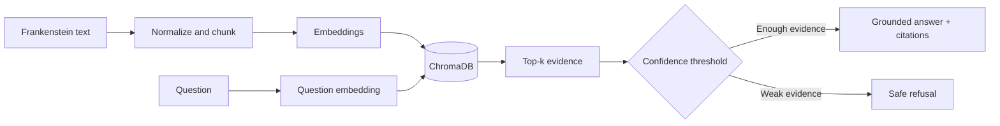

# Frankenstein RAG Assistant

A portfolio-ready Retrieval-Augmented Generation project that uses Mary
Shelley's *Frankenstein* as a document knowledge base. It retrieves relevant
passages, generates evidence-grounded answers, adds source references, refuses
weakly supported questions, and includes an evaluation workflow.

## Highlights

- End-to-end RAG pipeline
- Overlapping chunking and semantic retrieval
- ChromaDB cosine-similarity index
- Confidence-based safe refusal
- Chunk-level evidence and citations
- Twelve-question evaluation design
- Controlled chunk-size and top-k experiments
- Gradio demo interface
- Modular Python package and tests

## Structure

```text
frankenstein-rag-assistant/
├── app.py
├── notebooks/frankenstein_rag.ipynb
├── src/frankenstein_rag/
├── data/
├── tests/
├── docs/index.html
├── .env.example
├── requirements.txt
└── README.md
```

## Architecture



## Run locally

```bash
python -m venv .venv
pip install -r requirements.txt
```

Copy `.env.example` to `.env`, add your API key, and set an available chat model.
Then run:

```bash
python app.py
```

Upload a UTF-8 text edition of *Frankenstein*, build the index, and ask questions.

## Evaluation

The notebook includes Recall@k, MRR, answer accuracy, refusal accuracy,
citation accuracy, latency, token usage, controlled experiments, charts,
and error analysis.

## Security

Never commit `.env`, API keys, tokens, or private documents.

## Author

**Aynura Akhmedova** — Computational Linguistics · NLP · Python

## Fetching 1900-1930 sources automatically

```bash
pip install -r requirements.txt
python -m src.frankenstein_rag.fetch_sources gutenberg --max-books 20 --bookshelf "Short Stories"
python -m src.frankenstein_rag.fetch_sources newspapers --query "influenza" --max-pages 30
python -m src.frankenstein_rag.fetch_sources all
```

### O'zbekcha manbalar (1900-1930)

```bash
python -m src.frankenstein_rag.fetch_sources uzbek-newspapers
python -m src.frankenstein_rag.fetch_sources uzbek-press --max-items 50
python -m src.frankenstein_rag.fetch_sources uzbek-prose --authors qodiriy,cholpon,fitrat
```

- **Gazeta maqolalari** (`uzbek-newspapers`): jadid matbuoti bo'limidagi barcha
  maqolalar tekshiriladi, oxiridagi manba satri (masalan «Muştum» — 1923 yil, 7-son)
  bo'yicha gazetadan olinganlari `data/raw/uzbek/newspapers/<gazeta>/` ga saqlanadi
  (Muştum, Turkiston, Iştirokiyun, Qizil bayroq, Hurriyat, Sadoi Farğona va b.).
  Jurnallar (Inqilob, Oyna, Kengaş...) olinmaydi. Gazeta nomi va soni manifestda
  (`newspaper`, `issue_line`). To'liq sonlar emas, alohida maqolalar.
- **Jadid matbuoti** (`uzbek-press`): ziyouz.uz'dagi gazeta/jurnal maqolalari
  (Qodiriy, Fitrat, Hamza, Avloniy ...). Faqat sarlavhasida 1900-1930 yili
  ko'rsatilganlar olinadi; yilsizlari uchun `--include-undated`.
- **Nasr** (`uzbek-prose`): hikoya va romanlar; yil yo'q, shuning uchun muallifning
  yashagan yillari bo'yicha tanlanadi. Sayt romanlarning faqat parchasini beradi,
  shuning uchun to'liq PDF (n.ziyouz.com) yuklanib, matni `pdftotext` bilan
  ajratiladi (`apt install poppler-utils` kerak). Bunday fayllar kirill yozuvida
  bo'ladi; PDF topilmasa parcha saqlanadi va manifestda `excerpt_only: true` turadi.
  Faqat parcha kerak bo'lsa: `--excerpts-only`.
- Matn `?lng=lat` varianti: 1920-yillar lotin imlosiga yaqin transliteratsiya
  (ö, ş, ç, ğ). Arab yozuvidagi asl skanerlar bu saytda yo'q.
- Saqlash joyi: `data/raw/uzbek/press/`, `data/raw/uzbek/prose/`.

- **Novels / stories**: Project Gutenberg. The catalogue has no original
  publication date, so books are selected by author lifespan overlapping
  1900-1930; a few titles may predate 1900 (e.g. *The Time Machine*, 1895).
- **Newspapers**: Library of Congress *Chronicling America* OCR text, restricted
  to pages dated 1900-1930 (exact dates are in the manifest).
- Files land in `data/raw/gutenberg/` and `data/raw/newspapers/`;
  `data/raw/manifest.jsonl` records the source URL of each file.
  Downloaded texts are git-ignored. Index them with
  `FrankensteinRAG().index_directory("data/raw/newspapers")`.
- Requests are rate-limited; keep `--max-*` modest to be polite to both sites.
